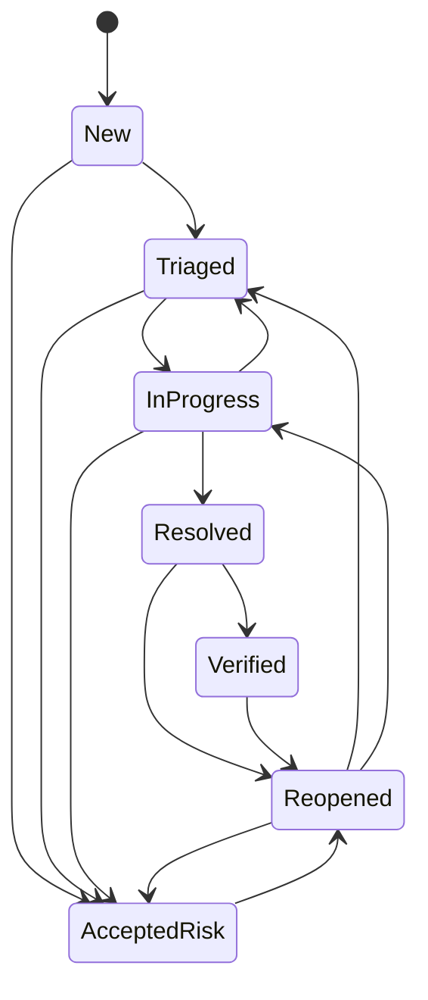

# Gestão de vulnerabilidades — documentação técnica

Este documento descreve o módulo de vulnerabilidades do SentinelForge (Fase 4): modelo, classificação CVSS, workflow,
permissões, histórico, indicadores e integração com o NVD. O resumo de uso está no [README](../README.md).

## 1. Modelo

```
applications 1───* vulnerabilities 1───* vulnerability_history
                         │ *───0..1 users (responsável)
                         │ *───1    users (criador)
                         └ *───0..1 users (quem informou a correção)
```

### `vulnerabilities`

| Campo | Observações |
|---|---|
| `Id`, `Title`, `Description`, `Category`, `Remediation` | `Title` e `Category` obrigatórios. |
| `CvssScore`, `CvssVersion`, `CvssVector` | Opcionais **em conjunto**: sem avaliação, os três ficam nulos. Versões aceitas: `3.0`, `3.1`, `4.0`. |
| `Severity` | **Sempre derivada** de `CvssScore` (ver §2). `Unrated` quando não há pontuação. |
| `Status` | Ver §3. Começa em `New`. |
| `CveId` | Opcional; normalizado em maiúsculas; formato `CVE-AAAA-NNNN+`. |
| `DiscoveredAt`, `ResolvedAt`, `VerifiedAt` | UTC. `ResolvedAt` existe em `Resolved` e `Verified`; `VerifiedAt` só em `Verified`. |
| `ResolvedByUserId` | Quem informou a correção; base da segregação de funções. |
| `ApplicationId`, `AssignedUserId`, `CreatedByUserId` | Chaves estrangeiras `RESTRICT` (nada é apagado fisicamente). |
| `CreatedAt`, `UpdatedAt` | UTC; `UpdatedAt` só muda quando algo muda de fato. |
| `xmin` | Token de concorrência otimista do PostgreSQL: duas alterações simultâneas não se sobrescrevem; a segunda recebe `409`. |

### `vulnerability_history` (append-only)

Uma linha por alteração: `ChangeType`, `Field`, `OldValue`, `NewValue`, `Justification`, `ActorUserId`, `IpAddress`, `CreatedAt`.

| `ChangeType` | Quando |
|---|---|
| `Created` | Criação. |
| `StatusChanged` | Qualquer transição de status, exceto as duas abaixo. |
| `RiskAccepted` | Transição para `AcceptedRisk` (com a justificativa). |
| `FixVerified` | Transição para `Verified`. |
| `SeverityChanged` | A severidade derivada mudou (valor antigo e novo). |
| `AssignmentChanged` | Responsável atribuído, trocado ou removido. |
| `DescriptionChanged` | Descrição alterada. |
| `DetailsChanged` | Título, categoria, CVE, remediação, pontuação ou vetor alterados (um registro por campo). |

O histórico é imutável em **três camadas**: não há endpoint de escrita; o `SaveChanges` rejeita `UPDATE`/`DELETE`
dessas linhas; e o PostgreSQL tem triggers que bloqueiam `UPDATE`, `DELETE` e `TRUNCATE` (SQLSTATE `42501`), inclusive
para acesso direto ao banco. Em paralelo, a auditoria genérica (`audit_logs`) continua registrando as alterações da entidade.

### Entidades avaliadas e não criadas

- **Comentários:** a justificativa de uma decisão já fica no histórico (`Justification`); uma entidade própria não teria
  endpoint nem regra de negócio nesta fase.
- **Referências:** as referências do NVD são devolvidas pela consulta CVE e não precisam de tabela. Persistir referências
  só faz sentido quando houver endpoint que as gerencie.

## 2. Classificação CVSS

Faixas oficiais do CVSS (escala qualitativa, iguais para 3.x e 4.0):

| Pontuação | Severidade |
|---|---|
| — (sem avaliação) | `Unrated` |
| 0.0 | `None` |
| 0.1 – 3.9 | `Low` |
| 4.0 – 6.9 | `Medium` |
| 7.0 – 8.9 | `High` |
| 9.0 – 10.0 | `Critical` |

- A pontuação tem de estar entre 0.0 e 10.0 com **uma casa decimal**.
- O cliente **nunca** envia a severidade; qualquer campo `severity` no corpo é ignorado.
- A divergência é impossível também no banco: o `CHECK ck_vulnerabilities_severity_matches_score` rejeita linhas em que a
  severidade não corresponde à pontuação.
- **Vetor:** se informado, é validado (prefixo `CVSS:<versão>/` igual à versão informada, todas as métricas base presentes
  com valores permitidos, sem repetição, métricas extras apenas no formato `CHAVE:VALOR`) e armazenado para rastreabilidade.
- **Limitação deliberada:** a pontuação **não é calculada a partir do vetor**. O cálculo do CVSS 4.0 depende das tabelas
  oficiais de MacroVector; uma implementação aproximada geraria notas erradas, e a regra é nunca inventar pontuações.
  A nota vem do avaliador ou do NVD. Consequência: a coerência entre vetor e nota não é verificada.

## 3. Workflow



| De | Para |
|---|---|
| `New` | `Triaged`, `AcceptedRisk` |
| `Triaged` | `InProgress`, `AcceptedRisk` |
| `InProgress` | `Resolved`, `Triaged`, `AcceptedRisk` |
| `Resolved` | `Verified`, `Reopened` |
| `Verified` | `Reopened` |
| `Reopened` | `Triaged`, `InProgress`, `AcceptedRisk` |
| `AcceptedRisk` | `Reopened` |

Regras:

- Transição fora da tabela → `409 Conflict`.
- `AcceptedRisk` **exige justificativa** (`400` sem ela), gravada no histórico.
- `Resolved` define `ResolvedAt` e `ResolvedByUserId`; `Verified` define `VerifiedAt`; qualquer outro destino limpa os três.
- **Aberta** = qualquer status exceto `Verified` e `AcceptedRisk` (`Resolved` ainda sem validação continua contando como aberta).
- **Segregação de funções:** quem moveu a vulnerabilidade para `Resolved` **não pode** movê-la para `Verified`
  (`403`), qualquer que seja o papel, inclusive `Administrator`. Configurável em `Vulnerabilities:RequireIndependentVerification`
  (padrão `true`).

## 4. Permissões

| Operação | Administrator | SecurityAnalyst | Developer |
|---|---|---|---|
| `POST /api/vulnerabilities` | sim | sim | **não** (403) |
| `GET` lista, detalhe, histórico, resumo | tudo | tudo | só aplicações autorizadas |
| `PUT /{id}` (dados e CVSS) | sim | sim | só o **responsável**, e **só a remediação** |
| `PATCH /{id}/assign` | sim | sim | não (403) |
| `PATCH /{id}/status` | qualquer transição válida | qualquer transição válida | só o **responsável**, só para `InProgress` e `Resolved` |
| Verificar (`Verified`) | sim, se for pessoa diferente de quem corrigiu | idem | não |
| `GET /api/cve/{id}` | sim | sim | não (403) |

**Aplicação autorizada (Developer):** a que ele possui (`OwnerUserId`) ou na qual é responsável por alguma vulnerabilidade.

**Anti-IDOR e anti-enumeração:** o escopo de acesso é aplicado na própria consulta ao banco. Um recurso que o usuário
não pode ver responde `404` com o mesmo corpo de um recurso inexistente, em todos os endpoints por id.
**Anti mass-assignment:** os DTOs de entrada só têm os campos permitidos; `status`, `severity`, `createdByUserId`,
`resolvedAt` etc. enviados pelo cliente são ignorados. O `PUT` de um Developer compara todos os demais campos com os
atuais e responde `403` se algum for diferente.

## 5. Endpoints

| Rota | Descrição |
|---|---|
| `POST /api/vulnerabilities` | Cadastra. `201` + `Location`. |
| `GET /api/vulnerabilities` | Lista paginada, com filtros e ordenação. |
| `GET /api/vulnerabilities/{id}` | Detalhe. |
| `PUT /api/vulnerabilities/{id}` | Atualiza dados e classificação (substituição completa; omitir o CVSS remove a avaliação). |
| `PATCH /api/vulnerabilities/{id}/status` | `{ "status": "...", "justification": "..." }` |
| `PATCH /api/vulnerabilities/{id}/assign` | `{ "assignedUserId": "<guid>" }` ou `null` para remover. O responsável precisa existir e estar ativo. |
| `GET /api/vulnerabilities/{id}/history` | Histórico, do mais recente ao mais antigo, paginado. |
| `GET /api/vulnerabilities/summary` | Indicadores (ver §6). |
| `GET /api/cve/{cveId}` | Consulta ao NVD (ver §7). |

### Listagem

| Parâmetro | Valores |
|---|---|
| `page` | ≥ 1 (padrão 1). |
| `pageSize` | 1–100 (padrão 20). |
| `sortBy` | `DiscoveredAt` (padrão), `CreatedAt`, `UpdatedAt`, `Title`, `Severity`, `CvssScore`, `Status`. |
| `sortDir` | `asc` ou `desc` (padrão `desc`). |
| `severity` | `Unrated`, `None`, `Low`, `Medium`, `High`, `Critical` (sem diferenciar maiúsculas; números são rejeitados). |
| `status` | Qualquer valor do workflow. |
| `applicationId`, `assignedUserId` | GUID. |
| `search` | Até 100 caracteres; busca literal (sem curingas) em título, descrição, categoria e CVE, sem diferenciar maiúsculas. |

Valores inválidos retornam `400` com a lista de erros por campo. `Severity` ordena por **ranking** (não alfabético) e
`CvssScore` ordena com vulnerabilidades sem avaliação sempre por último. A ordenação é estável (desempate por `Id`).

### Códigos de resposta

`400` validação · `401` sem autenticação · `403` papel não permite · `404` inexistente **ou** inacessível ·
`409` transição inválida ou alteração concorrente · `429` limite de requisições · `503` NVD indisponível.

## 6. Indicadores (`/summary`)

Todos calculados no PostgreSQL com agregações (`GROUP BY`/`COUNT`/`AVG`), restritos ao que o usuário pode ver:

| Campo | Definição |
|---|---|
| `total` | Vulnerabilidades no escopo. |
| `bySeverity`, `byStatus` | Contagem por valor; valores sem ocorrência aparecem com `0`. |
| `openCritical` | `Critical` em qualquer status exceto `Verified` e `AcceptedRisk`. |
| `byApplication` | Até 50 aplicações, da maior contagem para a menor. |
| `byAssignee` | Até 50 responsáveis; `userId: null` agrupa as não atribuídas. |
| `averageResolutionHours` | Média de `ResolvedAt − DiscoveredAt` das vulnerabilidades atualmente `Resolved`/`Verified`. **`null`** quando não há nenhuma. |
| `resolvedSampleSize` | Quantas entraram na média. |

Vulnerabilidades reabertas deixam de contar na média (a resolução foi desfeita).

## 7. Integração com o NVD

`GET /api/cve/{cveId}` consulta a [API 2.0 do NVD](https://nvd.nist.gov/developers/vulnerabilities)
(`https://services.nvd.nist.gov/rest/json/cves/2.0?cveId=...`).

**Resposta:** `cveId`, `description` (em inglês), `publishedAt`, `lastModifiedAt`, `vulnStatus`, `metrics` (CVSS 3.0, 3.1 e 4.0:
versão, nota, severidade, vetor, fonte e tipo), `preferredMetric`, `references`, e a origem preservada em
`source` (`NVD`), `sourceUrl` (página do CVE no NVD) e `retrievedAt`.

- **Métrica preferida:** a de maior versão do CVSS; em empate, a de tipo `Primary`.
- **Severidade:** recalculada pelas faixas oficiais a partir da nota (e conferida em teste contra o `baseSeverity` do NVD).
- **Dados externos não são confiáveis:** só URLs `http(s)` absolutas são mantidas nas referências; notas fora de 0–10 ou
  com mais de uma casa decimal e versões do CVSS não suportadas (ex.: 2.0) são descartadas; o CVE retornado precisa ser
  o solicitado; a resposta é limitada a 2 MB.
- **Entrada:** o identificador é validado (`CVE-AAAA-NNNN+`) e só então vai para a consulta, escapado; nada além disso
  chega à URL externa.

### Resiliência

| Situação | Comportamento |
|---|---|
| Timeout (padrão 10 s), erro de rede, 5xx, resposta inválida | `503` + `Retry-After`. |
| NVD responde `429`/`403` | `429` + `Retry-After` (respeita o cabeçalho do NVD). |
| Falha recente | **Disjuntor:** por 30 s novas consultas são recusadas localmente, sem martelar o serviço. |
| Limite de uso | Cliente limita-se a 4 req/30 s sem chave (teto oficial: 5) ou 45 req/30 s com chave (teto: 50). |
| Consulta repetida | Cache em memória: 60 min para CVE encontrado, 10 min para inexistente. |
| Qualquer das acima | Só `/api/cve` é afetado; o restante da plataforma segue normal. |

O endpoint exige papel `Administrator` ou `SecurityAnalyst` e tem limite próprio por IP (padrão 20/min), para que a
plataforma não sirva de proxy aberto para a cota do NVD. A chave de API é opcional (`Nvd__ApiKey`), enviada apenas no
cabeçalho `apiKey` e nunca registrada em logs. Os limites de cache e do cliente valem **por instância**; com várias
instâncias, a cota do NVD é compartilhada.

## 8. Configuração

| Variável | Padrão | Descrição |
|---|---|---|
| `Vulnerabilities__RequireIndependentVerification` | `true` | Segregação de funções na verificação. |
| `Nvd__ApiKey` | — | Chave de API do NVD (opcional, secreta). |
| `Nvd__BaseUrl` | URL oficial | Precisa ser `https`. |
| `Nvd__TimeoutSeconds` | `10` | 1–60. |
| `Nvd__CacheMinutes`, `Nvd__NotFoundCacheMinutes` | `60`, `10` | |
| `Nvd__UnavailableCooldownSeconds` | `30` | Duração do disjuntor. |
| `RateLimiting__CvePermitLimit`, `RateLimiting__CveWindowSeconds` | `20`, `60` | Limite do endpoint CVE, por IP. |

## 9. Testes

- **Unitários:** faixas do CVSS em todas as fronteiras, validação de vetores, matriz completa de transições (49 pares),
  justificativa obrigatória, datas de resolução/verificação, histórico, atribuição.
- **Persistência (PostgreSQL real):** `CHECK` de severidade × pontuação, de intervalo e de datas, trigger append-only
  (inclusive acesso direto), concorrência otimista.
- **API (PostgreSQL real, banco isolado por execução):** cadastro válido/inválido, mass assignment, RBAC por papel, IDOR e
  não-enumeração em todos os endpoints por id, filtros, paginação, ordenação, busca literal, atribuição, workflow,
  aceitação de risco, validação independente (e a política relaxada), histórico, dashboard com números verificáveis.
- **NVD:** parser contra **respostas reais** capturadas da API (fixtures em `tests/SentinelForge.IntegrationTests/Fixtures/Nvd`,
  sem edição), conferindo a severidade calculada com o `baseSeverity` do próprio NVD; cliente com falhas de transporte
  simuladas (timeout, 5xx, 429, JSON inválido, resposta gigante, disjuntor, limite de uso, cache, cancelamento); endpoint
  com NVD indisponível mantendo `/health`, listagem e dashboard funcionando. Nenhum teste inventa dados de CVE.
